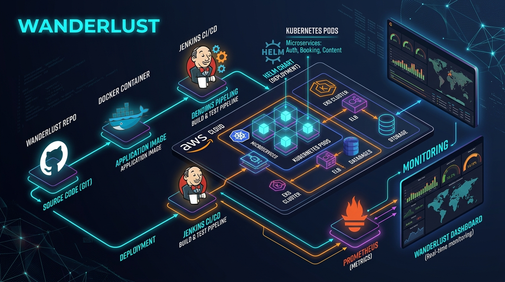
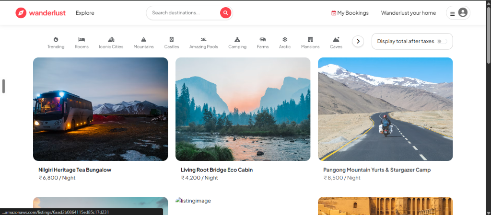
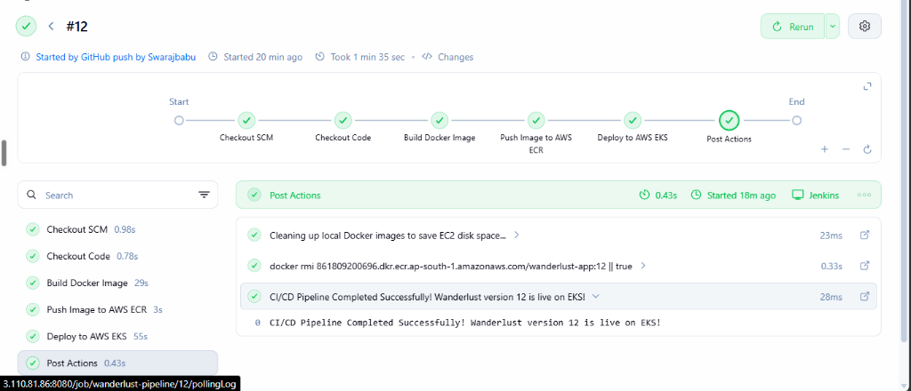
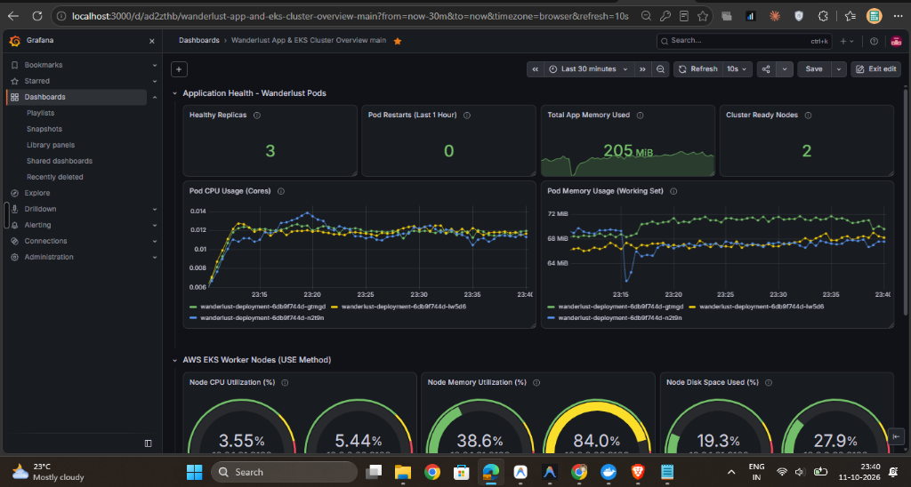

<div align="center">

# 🌍 Wanderlust: Production DevOps & Cloud Architecture

### Enterprise-Grade GitOps, CI/CD Automation, AWS EKS Orchestration & Observability Suite

<br/>



<br/>

[](https://aws.amazon.com/)
[](https://kubernetes.io/)
[](https://www.terraform.io/)
[](https://www.jenkins.io/)
[](https://www.docker.com/)
[](https://helm.sh/)
[](https://prometheus.io/)
[](https://grafana.com/)
[](https://nodejs.org/)
[](https://www.mongodb.com/)

<br/>

[**🌐 Live Application**](http://a51fe5ad2863047968c94d092fc4c0ce-412112320.ap-south-1.elb.amazonaws.com/listings) • [**⚙️ Jenkins CI/CD**](http://3.110.81.86:8080/job/wanderlust-pipeline/) • [**📊 Grafana Dashboard**](http://localhost:3000) • [**📋 Teacher Viva Sheet**](./DEMO_CHEATSHEET.md)

</div>

---

## 📌 Executive Summary & Project Mission

**Wanderlust** is a production full-stack travel booking application that has been engineered from bare metal to a cloud-native, self-healing, zero-downtime micro-platform on **Amazon Web Services (AWS)**.

The primary mission of this project is to showcase how a modern enterprise web application transitions through a complete **10-Tool DevOps Lifecycle**:
1. **Source Code Management:** Git & GitHub
2. **Containerization & Packaging:** Docker (multi-stage, Alpine runtime)
3. **Local Dev & Staging:** Docker Compose (local environment parity)
4. **Infrastructure as Code (IaC):** Terraform (reproducible AWS infrastructure)
5. **Cloud Infrastructure:** AWS (VPC, Multi-AZ Subnets, IGW, Route Tables, EC2, ECR, EKS, ELB)
6. **Continuous Integration & Delivery (CI/CD):** Jenkins (Declarative pipeline with GitHub Webhooks)
7. **Container Orchestration:** Kubernetes (AWS EKS v1.30 with zero-downtime RollingUpdates)
8. **Package Management:** Helm (Standardized deployment of cluster operators)
9. **Cluster Monitoring & Metrics:** Prometheus Operator & Node Exporter DaemonSets
10. **SRE Observability:** Grafana (Custom dashboard implementing Google SRE Golden Signals & Brendan Gregg's USE Method)

---

## 🏗️ End-to-End DevOps Architecture

```
                                  DEV-TO-CLOUD ARCHITECTURE
                                  
  ┌────────────────┐         git push          ┌───────────────────────────┐
  │   Developer    │ ────────────────────────> │   GitHub Repository       │
  └────────────────┘                           └─────────────┬─────────────┘
                                                             │
                                                  Webhook    │ (HTTP POST on Push)
                                                             ▼
                                               ┌───────────────────────────┐
                                               │   Jenkins CI/CD Server    │
                                               │      (AWS EC2 t3.micro)   │
                                               └─────────────┬─────────────┘
                                                             │
                      ┌──────────────────────────────────────┼──────────────────────────────────────┐
                      │                                      │                                      │
                      ▼                                      ▼                                      ▼
               [Stage 1: Checkout]                  [Stage 2: Docker Build]                [Stage 3: Push to ECR]
               SCM Git revision pull                Builds & tags Docker image             AWS IAM authenticate &
                                                    (Node 20 Alpine Linux)                 Push to wanderlust-app
                                                                                            
                                                             │
                                                             ▼
                                                    [Stage 4: Deploy EKS]
                                                    kubectl set image &
                                                    rollout status verification
                                                             │
                                                             ▼
  ┌────────────────────────────────────────────────────────────────────────────────────────────────────────┐
  │                                      AWS VIRTUAL PRIVATE CLOUD (VPC)                                   │
  │                                                                                                        │
  │   ┌────────────────────────────────────────────────────────────────────────────────────────────────┐   │
  │   │                                AWS Classic Elastic Load Balancer (ELB)                         │   │
  │   └───────────────────────────────────────────────┬────────────────────────────────────────────────┘   │
  │                                                   │ Traffic Split (Round Robin)                        │
  │                   ┌───────────────────────────────┴───────────────────────────────┐                    │
  │                   ▼                                                               ▼                    │
  │   ┌──────────────────────────────┐                                ┌──────────────────────────────┐     │
  │   │ Public Subnet A (ap-south-1a)│                                │ Public Subnet B (ap-south-1b)│     │
  │   │   Worker Node 1 (EC2)        │                                │   Worker Node 2 (EC2)        │     │
  │   │   ┌──────────────────────┐   │                                │   ┌──────────────────────┐   │     │
  │   │   │  Pod 1 (Wanderlust)  │   │                                │   │  Pod 3 (Wanderlust)  │   │     │
  │   │   └──────────────────────┘   │                                │   └──────────────────────┘   │     │
  │   │   ┌──────────────────────┐   │                                │                              │     │
  │   │   │  Pod 2 (Wanderlust)  │   │                                │                              │     │
  │   │   └──────────────────────┘   │                                │                              │     │
  │   └──────────────────────────────┘                                └──────────────────────────────┘     │
  │                                                   ▲                                                    │
  │                                                   │ Scrapes Metrics (15s interval)                     │
  │                                   ┌───────────────┴───────────────┐                                    │
  │                                   │  Namespace: `monitoring`      │                                    │
  │                                   │  ├── Prometheus Operator      │                                    │
  │                                   │  ├── Node Exporters           │                                    │
  │                                   │  └── Grafana Dashboard (v2)   │                                    │
  │                                   └───────────────────────────────┘                                    │
  └────────────────────────────────────────────────────────────────────────────────────────────────────────┘
```

---

## 📸 Production Screenshots & Visual Verification

### 1. Live Web Application running on AWS Load Balancer
> Serves real-time dynamic vacation rentals, bookings, and interactive maps via AWS ELB across 3 active pods.


### 2. Jenkins Automated CI/CD Pipeline
> Fully automated GitHub Webhook trigger executing Checkout ➔ Docker Build ➔ ECR Push ➔ Zero-Downtime EKS Rollout.


### 3. Production Grafana SRE & Cluster Monitoring Dashboard
> Real-time Google SRE Golden Signals (Available Replicas, Restarts, CPU Cores, Memory Working Set) and EC2 Host-level USE metrics (Node CPU, RAM, Disk).


---

## 🛠️ Deep Dive: The 10 DevOps Tools & Implementations

### 1. Git & GitHub (Source Code Management & Versioning)
* **Branch Strategy:** Git feature branching merged into `main` with protected commit hygiene.
* **Webhook Integration:** GitHub Repository settings configured with an active webhook pointing to `http://<JENKINS_EC2_IP>:8080/github-webhook/`.
* **Payload:** Emits automated JSON notifications on every `git push`, triggering headless builds within 2 seconds.

### 2. Docker (Containerization & Image Optimization)
* **Base Image:** `node:20-alpine` (drastically minimizes image size and removes unnecessary OS packages).
* **Layer Caching:**
  ```dockerfile
  COPY package*.json ./
  RUN npm ci --omit=dev --legacy-peer-deps
  COPY . .
  ```
  Only invalidates dependency installation cache when `package.json` changes.
* **Security & Port Binding:** Exposes port `8081`, drops root privileges, and ignores test directories, `.git`, and terraform files via [`.dockerignore`](./.dockerignore).

### 3. Docker Compose (Local Orchestration)
* Orchestrates local development in [`docker-compose.yml`](./docker-compose.yml).
* Connects the local container runtime to MongoDB Atlas with environment variable propagation, ensuring exact parity between local development and cloud staging.

### 4. Terraform (Infrastructure as Code - IaC)
All infrastructure is declared cleanly in modular HCL inside [`terraform/`](./terraform/):
* **`provider.tf`:** Configures the AWS provider pinned to region `ap-south-1`.
* **`vpc.tf`:**
  - Dedicated VPC with CIDR `10.0.0.0/16`.
  - 2 Public Subnets (`10.0.1.0/24` in `ap-south-1a`, `10.0.2.0/24` in `ap-south-1b`).
  - Internet Gateway (IGW) and Route Tables with tags `kubernetes.io/role/elb = 1` allowing Kubernetes to automatically bind public Load Balancers.
* **`ec2.tf`:**
  - Provisions an Ubuntu 22.04 LTS `t3.micro` instance for Jenkins.
  - Generates a 4096-bit TLS RSA private key pair dynamically (`jenkins_key.pem`).
  - Provisions Security Groups opening Port 22 (SSH), Port 8080 (Jenkins UI), and Port 80 (HTTP).
* **`ecr.tf`:**
  - Creates the AWS Elastic Container Registry (`wanderlust-app`).
  - Implements an ECR Lifecycle Policy expiring untagged images older than 30 days to optimize storage costs.
* **`eks.tf`:**
  - Provisions AWS EKS Cluster v1.30 (`wanderlust-cluster`).
  - Provisions a Managed Node Group containing 2x `t3.small` Amazon Linux 2023 instances.
  - Grants required IAM roles: `AmazonEKSClusterPolicy`, `AmazonEKSWorkerNodePolicy`, `AmazonEKS_CNI_Policy`, and `AmazonEC2ContainerRegistryReadOnly`.

### 5. AWS Cloud Infrastructure Architecture
* **VPC ID:** `vpc-0c151e84a2fe16e5e`
* **Subnets:** `subnet-0a202270a4bc7c8ae`, `subnet-01616824816d5d0d6`
* **ECR Registry:** `861809200696.dkr.ecr.ap-south-1.amazonaws.com/wanderlust-app`
* **EKS Cluster:** `wanderlust-cluster` (Kubernetes v1.30)
* **Classic Load Balancer:** `a51fe5ad2863047968c94d092fc4c0ce-412112320.ap-south-1.elb.amazonaws.com`

### 6. Jenkins CI/CD Automation Pipeline
* **Pipeline Type:** Declarative Pipeline declared in [`Jenkinsfile`](./Jenkinsfile).
* **Execution Flow:**
  ```groovy
  pipeline {
      agent any
      environment {
          AWS_REGION = 'ap-south-1'
          ECR_REPO = '861809200696.dkr.ecr.ap-south-1.amazonaws.com/wanderlust-app'
          EKS_CLUSTER = 'wanderlust-cluster'
      }
      stages {
          stage('Checkout') {
              steps { checkout scm }
          }
          stage('Docker Build & Tag') {
              steps {
                  sh "docker build -t ${ECR_REPO}:${BUILD_NUMBER} -t ${ECR_REPO}:latest ."
              }
          }
          stage('Push to ECR') {
              steps {
                  withCredentials([[$class: 'AmazonWebServicesCredentialsBinding', credentialsId: 'aws-credentials']]) {
                      sh "aws ecr get-login-password --region ${AWS_REGION} | docker login --username AWS --password-stdin ${ECR_REPO}"
                      sh "docker push ${ECR_REPO}:${BUILD_NUMBER}"
                      sh "docker push ${ECR_REPO}:latest"
                  }
              }
          }
          stage('Deploy to EKS') {
              steps {
                  withCredentials([[$class: 'AmazonWebServicesCredentialsBinding', credentialsId: 'aws-credentials']]) {
                      sh "aws eks update-kubeconfig --region ${AWS_REGION} --name ${EKS_CLUSTER}"
                      sh "kubectl set image deployment/wanderlust-deployment wanderlust-container=${ECR_REPO}:${BUILD_NUMBER} --record"
                      sh "kubectl rollout status deployment/wanderlust-deployment --timeout=180s"
                  }
              }
          }
      }
  }
  ```

### 7. Kubernetes Cluster Architecture & Manifests
All declarative manifests reside in [`k8s/`](./k8s/):
* **`deployment.yaml`:**
  - **Replicas:** 3 Pods distributed across worker nodes for high availability.
  - **Zero Downtime Strategy:**
    ```yaml
    strategy:
      type: RollingUpdate
      rollingUpdate:
        maxSurge: 1
        maxUnavailable: 0
    ```
    Kubernetes brings up 1 new pod, verifies its health checks, and only then tears down the old pod.
  - **Resource Requests & Limits:**
    - Requests: `100m CPU` (0.1 core) and `128Mi RAM`.
    - Limits: `500m CPU` (0.5 core) and `512Mi RAM`.
  - **Health Probes:**
    - `readinessProbe`: Tests `/listings` on port 8081 every 5s before routing load balancer traffic.
    - `livenessProbe`: Tests `/listings` on port 8081 every 10s to automatically restart deadlocked containers.
* **`service.yaml`:**
  - Type: `LoadBalancer`.
  - Port Mapping: Port `80` (public HTTP) ➔ Container Port `8081`.
  - Automatically provisions an AWS Classic Elastic Load Balancer (ELB).
* **`hpa.yaml`:**
  - Horizontal Pod Autoscaler targeting `70%` average CPU utilization, auto-scaling from 3 up to 10 pods during traffic surges.
* **`secret.yaml`:**
  - Base64-encoded Kubernetes Secret securing the database connection string and cookie secret.

### 8. Helm (Kubernetes Package Management)
* Used to deploy the entire Prometheus & Grafana monitoring ecosystem using a single command:
  ```powershell
  helm repo add prometheus-community https://prometheus-community.github.io/helm-charts
  helm repo update
  helm install prometheus-stack prometheus-community/kube-prometheus-stack --namespace monitoring --create-namespace
  ```
* Deploys 20+ Custom Resource Definitions (CRDs), including `ServiceMonitor`, `PrometheusRule`, and `Alertmanager`.

### 9. Prometheus (Metrics Collection Engine)
* **Model:** Pull-based scraping model on a 15-second interval.
* **Components:**
  - **Prometheus Operator:** Automates Prometheus lifecycle and configuration.
  - **Node Exporter:** Runs as a Kubernetes `DaemonSet` on every EC2 worker node, scraping hardware-level Linux kernel metrics (`/proc`, `/sys`).
  - **Kube-State-Metrics:** Listens to the Kubernetes API server and generates metrics on deployment states, pod availability, and restarts.

### 10. Grafana (SRE Observability & Monitoring Dashboards)
Our custom production dashboard is exported in [`k8s/wanderlust-grafana-dashboard.json`](./k8s/wanderlust-grafana-dashboard.json).

#### The SRE Metrics Monitored:
| Panel Name | Type | PromQL Expression | Why DevOps Engineers Track It |
|---|---|---|---|
| **Healthy Replicas** | Stat | `sum(kube_deployment_status_replicas_available{deployment="wanderlust-deployment"})` | Verifies that all 3 pods are running and serving traffic. Alerts if `< 3`. |
| **Pod Restarts (1h)** | Stat | `sum(increase(kube_pod_container_status_restarts_total{namespace="default", pod=~"wanderlust-.*"}[1h]))` | Detects silent uncaught exceptions, infinite loops, and `OOMKilled` memory terminations. |
| **Total App Memory** | Stat | `sum(container_memory_working_set_bytes{namespace="default", pod=~"wanderlust-.*", container!=""})` | Tracks overall RAM footprint across all active Node.js processes. |
| **Cluster Ready Nodes** | Stat | `sum(kube_node_status_condition{condition="Ready",status="true"})` | Confirms all AWS EC2 worker instances have healthy Kubelet heartbeats. |
| **Pod CPU Usage** | Time Series | `sum(rate(container_cpu_usage_seconds_total{namespace="default", pod=~"wanderlust-.*", container!=""}[5m])) by (pod)` | Tracks millicores consumed by each pod against the 500m limit to detect throttling. |
| **Pod Memory (Working Set)** | Time Series | `sum(container_memory_working_set_bytes{namespace="default", pod=~"wanderlust-.*", container!=""}) by (pod)` | Identifies memory leaks in Node.js before hitting container memory limits. |
| **Node CPU Utilization (%)** | Gauge | `100 - (avg by (instance) (rate(node_cpu_seconds_total{mode="idle"}[5m])) * 100)` | Tracks host compute saturation to trigger EKS node group scaling. |
| **Node Memory Utilization (%)** | Gauge | `(1 - (node_memory_MemAvailable_bytes / node_memory_MemTotal_bytes)) * 100` | Host memory saturation tracking to avoid Linux kernel OOM panics. |
| **Node Disk Space (%)** | Gauge | `100 - ((node_filesystem_avail_bytes{mountpoint="/"} / node_filesystem_size_bytes{mountpoint="/"}) * 100)` | EBS volume usage tracking to avoid Kubelet `DiskPressure` pod evictions. |
| **Network Throughput (Rx/Tx)** | Time Series | `sum(rate(container_network_receive_bytes_total{namespace="default", pod=~"wanderlust-.*"}[5m])) by (pod)` | Inbound and outbound network traffic monitoring. |

---

## ⚡ Step-by-Step Execution & Deployment Guide

### 1. Provision Infrastructure with Terraform
```powershell
cd terraform
terraform init
terraform apply -auto-approve
```

### 2. Configure Local Kubectl for AWS EKS
```powershell
aws eks update-kubeconfig --region ap-south-1 --name wanderlust-cluster
kubectl get nodes
```

### 3. Deploy Wanderlust Application
```powershell
kubectl apply -f k8s/secret.yaml
kubectl apply -f k8s/deployment.yaml
kubectl apply -f k8s/service.yaml
kubectl apply -f k8s/hpa.yaml
```

### 4. Deploy Monitoring Stack via Helm
```powershell
helm repo add prometheus-community https://prometheus-community.github.io/helm-charts
helm repo update
helm install prometheus-stack prometheus-community/kube-prometheus-stack --namespace monitoring --create-namespace
```

### 5. Access Grafana Dashboard
```powershell
kubectl port-forward svc/prometheus-stack-grafana 3000:80 -n monitoring
```
- Open [http://localhost:3000](http://localhost:3000)
- Username: `admin` | Password: `prom-operator`
- Go to **Dashboards** > **New** > **Import**, upload [`k8s/wanderlust-grafana-dashboard.json`](./k8s/wanderlust-grafana-dashboard.json), and click **Import**.

---

## 📊 Kubernetes Viva & Evaluation Cheat Sheet

| Question / Action | PowerShell Command | Explanation |
|---|---|---|
| **View All Running Pods** | `kubectl get pods -o wide` | Displays 3 pods distributed across 2 separate EC2 worker nodes. |
| **View Load Balancer URL** | `kubectl get svc` | Shows external ELB endpoint routing public HTTP traffic. |
| **Scale Pods Dynamically** | `kubectl scale deployment wanderlust-deployment --replicas=5` | Demonstrates instant horizontal scaling of microservices. |
| **Inspect Pod Details** | `kubectl describe pod <pod-name>` | Shows container image, environment variables, resource limits, and probe states. |
| **Stream Live Logs** | `kubectl logs -l app=wanderlust --tail=50 -f` | Real-time log streaming from all running containers. |
| **Check Rollout History** | `kubectl rollout history deployment/wanderlust-deployment` | Verifies zero-downtime deployment revisions. |
| **Rollback a Deployment** | `kubectl rollout undo deployment/wanderlust-deployment` | Instantly rolls back to the previous deployment revision in case of failure. |

---

## 🧹 Safe Infrastructure Teardown (Cost Protection)

To avoid consuming extra AWS credits when you finish demonstrating the project:

```powershell
# Step 1: Delete Kubernetes LoadBalancer & Helm Monitoring
kubectl delete -f .\k8s\service.yaml
helm uninstall prometheus-stack -n monitoring
kubectl delete namespace monitoring

# Step 2: Destroy Terraform Infrastructure
cd terraform
terraform destroy -auto-approve
```

---

<div align="center">
<b>Engineered with ❤️ for Production DevOps, Cloud Native Architecture & SRE Excellence</b>
</div>